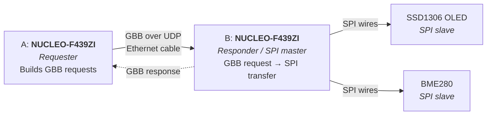

# RTS Open1722 Remote SPI

## Goal

Control an SPI OLED (and a BME280 sensor) remotely with IEEE 1722 Generic Byte Bus (GBB) messages. One Nucleo sends SPI transactions over Ethernet, a second Nucleo receives them and executes them on its SPI pins.

**Demo:** a button press on the sending board reads the temperature remotely and shows it on the remote OLED.

## System Overview

 
- **Network link:** A <-> B (Ethernet cable, static IPs, 1722 over UDP, Annex J)
- **SPI link:** B <-> OLED/BME280 (plain wires on the pins, no network)

## Notes
- Zephyr RTOS on both boards, Open1722 for GBB
- `byte_bus_id` selects the SPI device
- BME280 first as the simple test of the remote link, then the OLED

## Project Plan
 
| # | Task |
|---|---|
| 1 | **Setup:** Set up repo, Zephyr on both boards, read GBB spec (§9.4.14, Annex O, Annex J) |
| 2 | **Local test on Board B:** read BME280, then show text on the OLED, all without network |
| 3 | **Network test:** Ethernet + static IPs, UDP echo A <-> B |
| 4 | **GBB message:** Board A sends a GBB write request, Board B parses it and logs the bytes |
| 5 | **Responder:** map `byte_bus_id` -> SPI device, run the SPI transfer, send GBB response |
| 6 | **Milestone 1:** Board A reads the BME280 chip ID remotely |
| 7 | **Milestone 2:** Board A reads temperature, shows it on the remote OLED, button switches the page |
| 8 | **Finalisation:** Docs, demo, cleanup |

## Required Hardware
 
| Item | Amount |
|---|---|
| NUCLEO-F439ZI | 2 |
| SSD1306 OLED, SPI version | 1 |
| BME280 breakout, SPI-capable | 1 |
| Breadboard | 1 |
| Ethernet cable | 1 |
| USB cables for the Boards (power, flashing, serial) | 2 |
| Jumper wires (F-M, F-F, M-M) | a bunch |
| Optional: USB-C to Ethernet adapter | 1 |
 
(Double the amount would be nice for sub-group testing)
