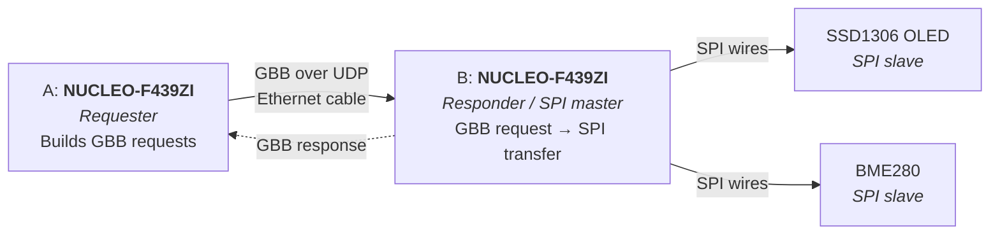

# RTS Open1722 Remote SPI

Control an SPI OLED display and a BME280 sensor remotely using IEEE 1722 Generic Byte Bus (GBB) messages. One Nucleo board sends SPI transactions over Ethernet, a second Nucleo receives them and executes them on its own SPI pins.

**Demo:** the Requester periodically reads the remote BME280 and shows the values on the remote OLED; its button cycles through the display pages.

## Overview



- **Network link:** Board A ↔ Board B over Ethernet (static IPs, IEEE 1722 over UDP, Annex J)
- **SPI link:** Board B ↔ OLED / BME280 over plain wires (no network)

See [Architecture](docs/architecture.md) for details.

## Tech Stack

- [Zephyr RTOS](https://zephyrproject.org/) on both boards
- [Open1722](https://github.com/COVESA/Open1722) for GBB message handling
- 2× NUCLEO-F439ZI, SSD1306 SPI OLED, BME280

## Quick Start

Full instructions: [Getting Started](docs/getting-started.md).

### 1. On the host: start OpenOCD and leave it running

Windows (PowerShell):
```powershell
openocd -f board/st_nucleo_f4.cfg -c "bindto 0.0.0.0" -c "reset_config srst_only srst_nogate connect_assert_srst"
```

Linux: start the Docker daemon first, so the `docker0` bridge (`172.17.0.1`) exists:
```bash
sudo systemctl start docker   # or `enable --now` to start it at every boot
openocd -f board/st_nucleo_f4.cfg -c "bindto 172.17.0.1" -c "reset_config srst_only srst_nogate connect_assert_srst"
```

### 2. In the dev container, from the workspace folder (e.g. /workspaces/RTS):
#### Get Open1722

```bash
git submodule update --init   # once, fetches Open1722
```

#### Build and Flash
Requester
```bash
west build -p always -b nucleo_f439zi app -d build/requester -- -DROLE=requester
west flash -d build/requester
```

Responder
```bash
west build -p always -b nucleo_f439zi app -d build/responder -- -DROLE=responder
west flash -d build/responder
```

## Documentation

| Document | Description |
|---|---|
| [Getting Started](docs/getting-started.md) | From plugging in the board to flashing the app |
| [Architecture](docs/architecture.md) | System design, links and demo flow |
| [Hardware](docs/hardware.md) | Required hardware list |
| [Project Plan](docs/project-plan.md) | Tasks, dependencies and milestones |
| [Troubleshooting](docs/troubleshooting.md) | Toolchain checks and common errors |
| [Open1722 Notes](docs/open1722-notes.md) | GBB support, known bugs, spec field summary |
| [Decisions](docs/adr/) | Architecture decision records |
| [Glossary](GLOSSARY.md) | Project terminology |

## Project Status

See the [Project Plan](docs/project-plan.md).