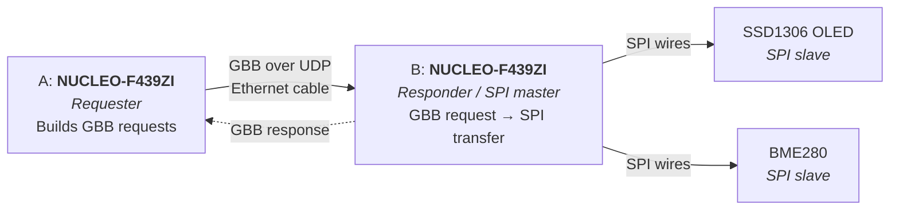

# RTS Open1722 Remote SPI

Control an SPI OLED display and a BME280 sensor remotely using IEEE 1722 Generic Byte Bus (GBB) messages. One Nucleo board sends SPI transactions over Ethernet, a second Nucleo receives them and executes them on its own SPI pins.

**Demo:** pressing a button on the sending board reads the temperature from the remote BME280 and shows it on the remote OLED.

## Overview



- **Network link:** Board A ↔ Board B over Ethernet (static IPs, IEEE 1722 over UDP, Annex J)
- **SPI link:** Board B ↔ OLED / BME280 over plain wires (no network)

See [Architecture](docs/architecture.md) for details.

## Tech Stack

- [Zephyr RTOS](https://zephyrproject.org/) on both boards
- [Open1722](https://github.com/COVESA/Open1722) for GBB message handling
- 2× NUCLEO-F439ZI, SSD1306 SPI OLED, BME280

## Quick Start

Full instructions: [Getting Started](docs/getting-started.md).

### 1. On Windows (PowerShell): start OpenOCD and leave it running
```bash
openocd -f board/st_nucleo_f4.cfg -c "bindto 0.0.0.0" -c "reset_config srst_only srst_nogate connect_assert_srst"
```

### 2. In the dev container, from /workspaces/RTS: build and flash
```bash
west build -p always -b nucleo_f439zi app -d build
west flash
```

## Documentation

| Document | Description |
|---|---|
| [Getting Started](docs/getting-started.md) | From plugging in the board to flashing the app |
| [Architecture](docs/architecture.md) | System design, links and demo flow |
| [Hardware](docs/hardware.md) | Required hardware list |
| [Project Plan](docs/project-plan.md) | Tasks, dependencies and milestones |
| [Troubleshooting](docs/troubleshooting.md) | Toolchain checks and common errors |

## Project Status

See the [Project Plan](docs/project-plan.md).