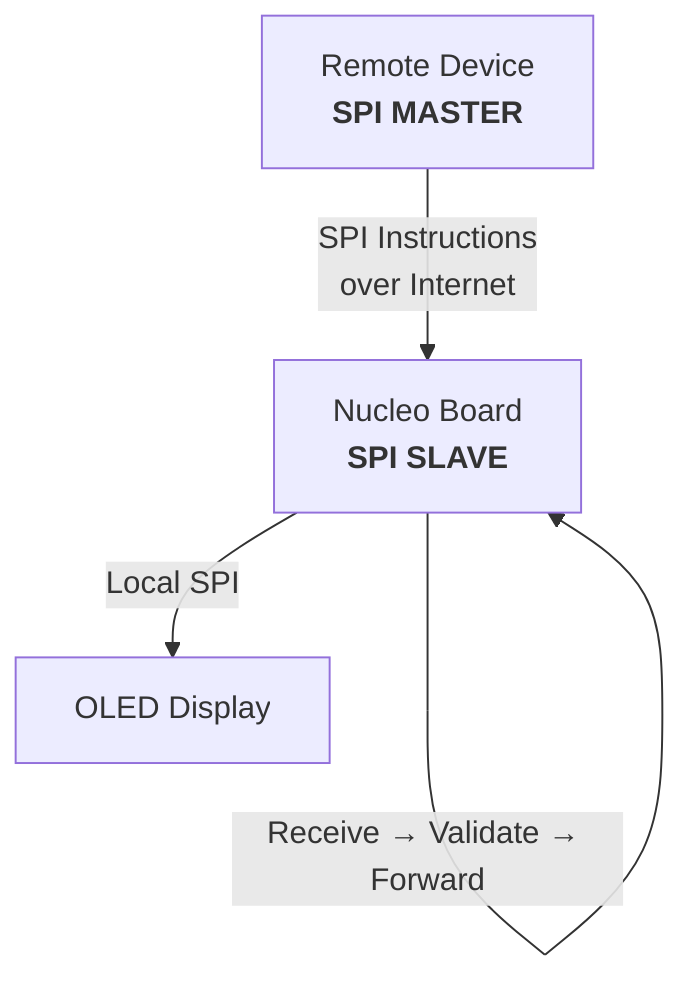

# RTS Open1722 REmote SPI

## System Overview

## First Project Plan

1. Identify Hardware and set it up
2. Make local board and component tests
3. Send message from the remote device to Board with 1722 and validate if received
4. Implement GBB on the board
5. AI recommends to extend the GBB header/payload for the OLED
6. Tranform message to a proper SPI message and send to the OLED

(Identify payload/header (and open1722's specifications/methods/whatever it can do for us) for the package of our SPI transaction)

## Required Hardware

- 4x Nucleo Board (we got 2 already)
- 2x SSD1306 SPI OLED Display (Waveshare, Adafruit)
- 2x Breadboard
- 2x Ethernet Cable
- a couple of "female to male", "female to female" and "male to male" cables
- 2x for testing purposes SPI Sensors like a BME280
- 1x USB-C to Ethernet Adapter
