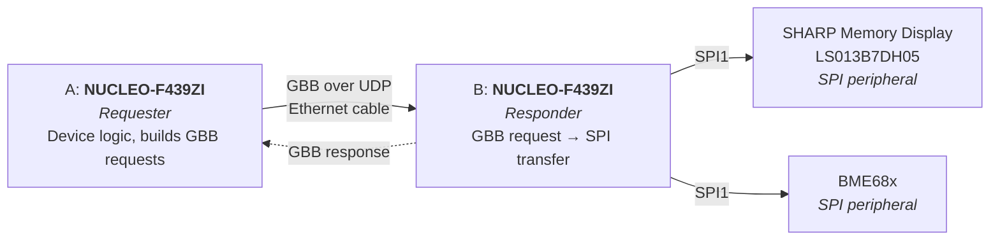
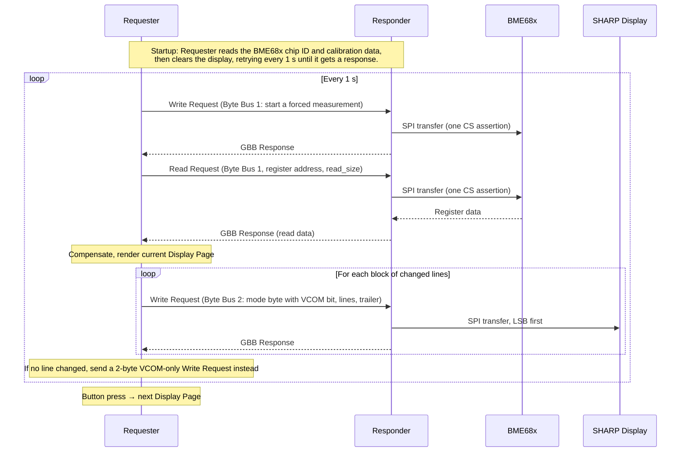

# Architecture

Terms in **bold** are defined in the [Glossary](../GLOSSARY.md). The reasons behind the main decisions are recorded in the [ADRs](adr/).

## System overview



| Link | Between | Medium | Protocol |
|---|---|---|---|
| Network | Requester ↔ Responder | Direct Ethernet cable, static IPs | IEEE 1722 over UDP (Annex J) |
| SPI | Responder ↔ Display / BME68x | Plain wires on the pins | SPI1, mode 0, 1 MHz, one CS per peripheral (settings per **Byte Bus**, see below) |

The peripherals are an Adafruit SHARP Memory Display 1.3" (LS013B7DH05, 144×168 pixels, monochrome, write-only) and a BME68x environmental sensor (BME680 or BME688: temperature, humidity, pressure, gas resistance). See [Hardware](hardware.md).

## Roles

- **Requester** (board A): holds all device knowledge. It has its own BME68x driver (register page selection, calibration data, compensation, gas heater setup if gas readings are used) and its own SHARP display driver (framebuffer, font rendering, line writes, VCOM inversion). It sends **GBB Requests**, handles the button, the **Display Pages** and the **Link Stats**.
- **Responder** (board B): a dumb byte bus. It runs each GBB Request as one raw SPI transfer on the selected **Byte Bus** and sends back a **GBB Response**. It does not use Zephyr's `bme680` or `ls0xx` drivers ([ADR 0001](adr/0001-responder-is-a-dumb-byte-bus.md)).

## Byte Buses

| `byte_bus_id` | Byte Bus | Peripheral | SPI settings |
|---|---|---|---|
| 0 | (unused, the spec's "unspecified" default) | none | answered with `err`=1 |
| 1 | Sensor Bus | BME68x | MSB first, CS active-low |
| 2 | Display Bus | SHARP Memory Display | LSB first, CS active-high, 3 µs CS setup / 1 µs CS hold |

The display's VCOM inversion is done by the Requester over SPI ([ADR 0003](adr/0003-sharp-display-is-one-byte-bus.md)).

## Protocol

**Framing.** One GBB message per UDP datagram:

```
UDP → Annex J header (4) → NTSCF v0 header (12) → GBB header (16) → payload → pad (0-3)
```

- Requester: 192.168.1.10, sends from an ephemeral port.
- Responder: 192.168.1.11, listens on UDP 17220 (the IANA AVTP port) and replies to the source address and port of the request.
- Open1722 builds and parses the headers, wrapped by `src/common/gbb.h`.
- NTSCF version 0 with `sv`=0 (stream without a reservation, §9.2.2). The `stream_id` is the sender's MAC address followed by a 16-bit ID (§4.6).
- Each sender increments the Annex J `encapsulation_sequence_num` and the NTSCF `sequence_num_lsb` per datagram. The receiver ignores both, and the `stream_id`.
- A datagram that isn't exactly one GBB message (a second ACF message, ABB, bytes left over) is dropped.

**Requests.**

- **Write Request** (`op`=1): the payload is clocked out in one CS assertion.
- **Read Request** (`op`=0): the payload (e.g. a register address) is clocked out, then `read_size` bytes are read in the same CS assertion. The response carries only the bytes read (Annex O → Annex M, Figure M.7). Only the Sensor Bus uses Read Requests; the display has no MISO.
- `read_size` is decoded as in §9.4.14.14: with bit 11 set, the value is in KiB (`0x800` also means 1 KiB).
- Segmentation (`ms`, `segment_num`) isn't used. Every request and response fits in one datagram.
- A full-screen display update is larger than one GBB message can carry, so the Requester splits display updates into several Write Requests and only sends lines that changed.

**Transactions.**

- At most one request is outstanding at a time. The timeout is 100 ms, with no retry.
- The Requester increments `transaction_num` for each request (wrapping at 255). The Responder echoes it together with `byte_bus_id` and `op`, and the Requester throws away any response where one of them doesn't match.
- A matching response fails if `err`=1 or if a read response doesn't carry exactly `read_size` bytes.

**Errors.**

| Situation on the Responder | Reaction |
|---|---|
| Valid GBB Request that can't be executed: unknown Byte Bus, Read Request on the Display Bus, `read_size` of 0 bytes or larger than the Responder's buffer, empty Write Request, segmented request (`ms`=1 or `segment_num`≠0), SPI failure, busy | GBB Response with `err`=1 |
| Datagram that doesn't parse: too short, not NTSCF v0 with exactly one GBB message, `rsp`=1 | Drop and log, no response |

On the Requester, a timeout and a failed matching response both count as a **Failed Transaction**.

## Status LEDs

| Board | LED | Meaning |
|---|---|---|
| Requester | Red (LD3) | On after a Failed Transaction, off again after the next successful one |
| Requester | Green (LD1) | Toggles on every successful GBB Response |
| Responder | Red (LD3) | On after a local SPI failure |

## Code layout

One Zephyr app. The shared core is used by both roles, and each role has its own `main.c`.

```
app/
  src/common/     GBB framing/parsing (gbb.h), UDP transport, protocol constants
  src/requester/  main, BME68x driver, SHARP display driver, display pages
  src/responder/  main, Byte Bus table (byte_bus_id → spi_config incl. CS)
  tests/common/   ztest suite for gbb.h on native_sim
  requester.conf / responder.conf
  boards/         per-role overlays for nucleo_f439zi
lib/open1722/     git submodule, pinned commit
```

The role is chosen at build time with `-DROLE=requester` or `-DROLE=responder`. From that, `app/CMakeLists.txt` adds `<role>.conf` and `boards/<board>_<role>.overlay`, and compiles `src/common/` plus `src/<role>/`. Open1722 is used header-only: its functions are `static inline`, so the build only adds `lib/open1722/include`.

## Wiring (Responder)

| Signal | MCU pin | Nucleo header | Peripheral pin |
|---|---|---|---|
| SPI1 SCK | PA5 | D13 | BME68x SCL/SCK, display CLK |
| SPI1 MISO | PA6 | D12 | BME68x SDO (the display has no MISO) |
| SPI1 MOSI | **PB5** | D22 (ZIO) | BME68x SDA/SDI, display DI |
| CS display | PD14 | D10 | display CS (active-high) |
| CS BME68x | PD15 | D9 | BME68x CS (active-low) |

The chip selects match the standalone [`air_quality`](../examples/air_quality) example, so the same wiring works for both. Only MOSI differs: the examples use the board's default PA7 (D11), but the app uses PB5, because PA7 carries the Ethernet RMII CRS_DV signal. Move the MOSI wire from D11 to PB5 when switching from an example to the app, and check the header position of PB5 against the NUCLEO-144 user manual (UM1974) before wiring.

The display's DISP and EXTMODE/EXTCOMIN pins stay unconnected (the breakout's defaults: display on, VCOM inverted over SPI).

## Demo flow



See [Project Plan](project-plan.md) for how this is built up step by step, and [Hardware](hardware.md) for the parts.
