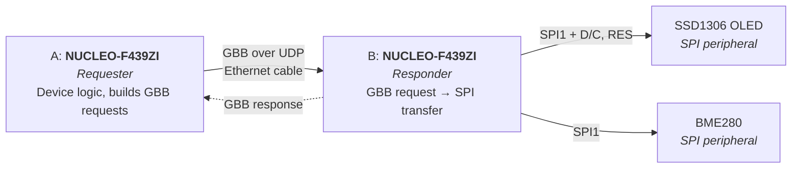
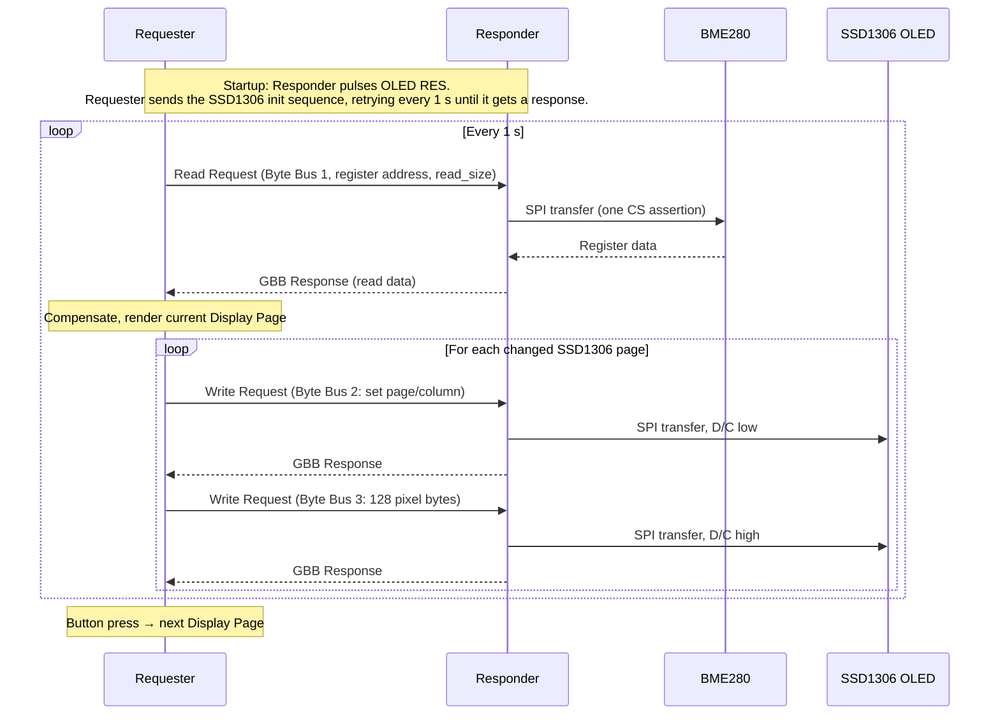

# Architecture

Terms in **bold** are defined in the [Glossary](../GLOSSARY.md). The reasons behind the main decisions are recorded in the [ADRs](adr/).

## System overview



| Link | Between | Medium | Protocol |
|---|---|---|---|
| Network | Requester ↔ Responder | Direct Ethernet cable, static IPs | IEEE 1722 over UDP (Annex J) |
| SPI | Responder ↔ OLED / BME280 | Plain wires on the pins | SPI1, mode 0, 1 MHz, one CS per peripheral |

## Roles

- **Requester** (board A): holds all device knowledge. It has its own BME280 driver (register reads, calibration, compensation) and its own SSD1306 driver (init sequence, framebuffer, font rendering). It sends **GBB Requests**, handles the button, the **Display Pages** and the **Link Stats**.
- **Responder** (board B): a dumb byte bus. It runs each GBB Request as one raw SPI transfer on the selected **Byte Bus** and sends back a **GBB Response**. It does not use Zephyr's `bme280` or `ssd1306` drivers ([ADR 0001](adr/0001-responder-is-a-dumb-byte-bus.md)).

## Byte Buses

| `byte_bus_id` | Byte Bus | Peripheral | Before the transfer |
|---|---|---|---|
| 0 | (unused, the spec's "unspecified" default) | none | answered with `err`=1 |
| 1 | BME280 | BME280 | none |
| 2 | OLED Command Bus | SSD1306 | D/C low |
| 3 | OLED Data Bus | SSD1306 | D/C high |

The OLED is one peripheral reached through two Byte Buses because the D/C line can't be carried in GBB ([ADR 0002](adr/0002-oled-dc-line-via-two-byte-buses.md)). The Responder pulses the OLED's RES line once at boot.

## Protocol

**Framing.** One GBB message per UDP datagram:

```
UDP → Annex J header (encapsulation_seq_no) → NTSCF header → one GBB ACF message
```

- Requester: 192.168.1.10, sends from an ephemeral port.
- Responder: 192.168.1.11, listens on UDP 17220 (the IANA AVTP port) and replies to the source address and port of the request.
- Open1722 builds and parses the headers.

**Requests.**

- **Write Request** (`op`=1): the payload is clocked out in one CS assertion.
- **Read Request** (`op`=0): the payload (e.g. a register address) is clocked out, then `read_size` bytes are read in the same CS assertion. The response carries only the bytes read (Annex O → Annex M, Figure M.7).
- Every payload is at most 255 bytes. That works around an Open1722 bug, see [Open1722 Notes](open1722-notes.md). The OLED is therefore updated one 128-byte SSD1306 RAM page at a time, and only pages that changed are sent.

**Transactions.**

- At most one request is outstanding at a time. The timeout is 100 ms, with no retry.
- The Requester increments `transaction_num` for each request (wrapping at 255). The Responder echoes it, and the Requester throws away any response whose number doesn't match.

**Errors.**

| Situation on the Responder | Reaction |
|---|---|
| Valid GBB Request that can't be executed: unknown Byte Bus, `read_size` of 0 or over 255, empty Write Request, SPI failure, busy | GBB Response with `err`=1 |
| Datagram that doesn't parse: too short, not NTSCF/GBB, `rsp`=1 | Drop and log, no response |

On the Requester, both a timeout and an `err`=1 response count as a **Failed Transaction**.

## Status LEDs

| Board | LED | Meaning |
|---|---|---|
| Requester | Red (LD3) | On after a Failed Transaction, off again after the next successful one |
| Requester | Green (LD1) | Toggles on every successful GBB Response |
| Responder | Red (LD3) | On after a local SPI failure |

## Code layout

One Zephyr app. The shared core is used by both roles, and each role has its own `main.c`.

```
app/
  src/common/     GBB framing/parsing, UDP transport
  src/requester/  main, BME280 driver, SSD1306 driver, display pages
  src/responder/  main, Byte Bus table (byte_bus_id → spi_config, CS, D/C)
  tests/          ztest suite for src/common/ on native_sim
  requester.conf / responder.conf
  boards/         per-role overlays for nucleo_f439zi
lib/open1722/     git submodule, pinned commit
```

The role is chosen at build time with `-DROLE=requester` or `-DROLE=responder`. From that, `app/CMakeLists.txt` adds `<role>.conf` and `boards/<board>_<role>.overlay`, and compiles `src/common/` plus `src/<role>/`. Open1722 is used header-only: its functions are `static inline`, so the build only adds `lib/open1722/include`.

## Wiring (Responder)

| Signal | MCU pin | Nucleo header | Peripheral pin |
|---|---|---|---|
| SPI1 SCK | PA5 | D13 | BME280 SCL/SCK, OLED CLK/D0 |
| SPI1 MISO | PA6 | D12 | BME280 SDO (the OLED has no MISO) |
| SPI1 MOSI | **PB5** | D22 (ZIO) | BME280 SDA/SDI, OLED DIN/D1 |
| CS BME280 | PD14 | D10 | BME280 CSB |
| CS OLED | PD15 | D9 | OLED CS |
| OLED D/C | PF12 | D8 | OLED DC |
| OLED RES | PF13 | D7 | OLED RES |

MOSI is on PB5 instead of the board's default PA7, because PA7 carries the Ethernet RMII CRS_DV signal. Check the header position of PB5 against the NUCLEO-144 user manual (UM1974) before wiring.

## Demo flow



See [Project Plan](project-plan.md) for how this is built up step by step, and [Hardware](hardware.md) for the parts.
