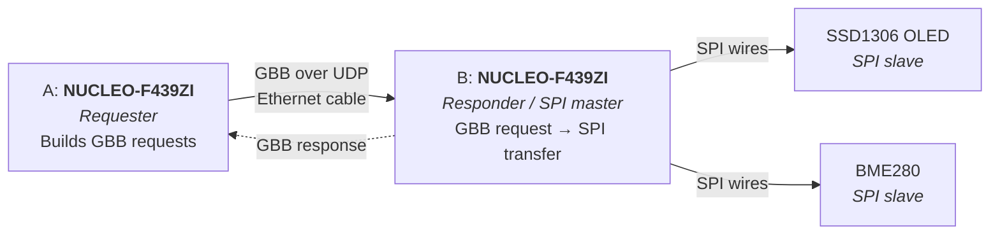
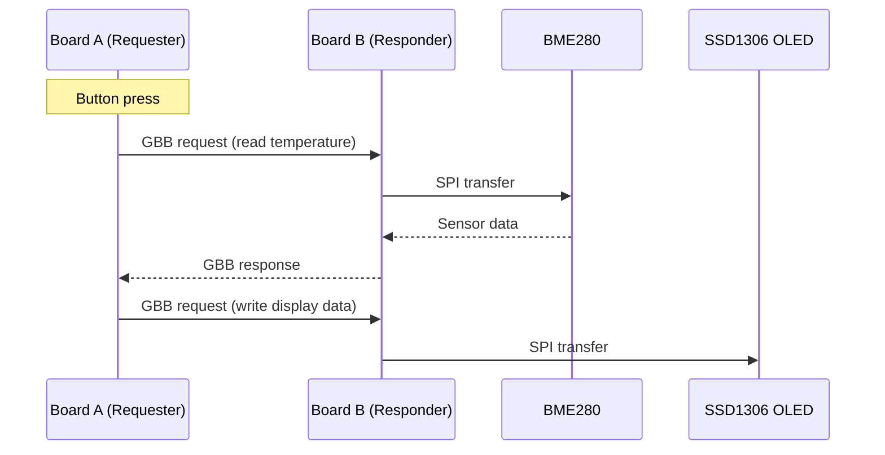

# Architecture

## System overview

| Link | Between | Medium | Protocol |
|---|---|---|---|
| Network | Board A ↔ Board B | Ethernet cable, static IPs | IEEE 1722 over UDP (Annex J) |
| SPI | Board B ↔ OLED / BME280 | Plain wires on the pins | SPI, no network |

## Roles

- **Board A (Requester):** builds GBB requests and sends them to Board B. Handles the button and the demo logic.
- **Board B (Responder / SPI master):** receives GBB requests, executes the SPI transfer on its pins and sends back a GBB response.

## Design notes

- Zephyr RTOS runs on both boards.
- [Open1722](https://github.com/COVESA/Open1722) is used for GBB message handling.
- The `byte_bus_id` field selects the SPI device on Board B.
- The BME280 is used first as the simple test of the remote link, then the OLED.
- Relevant spec sections: §9.4.14 (GBB), Annex O, Annex J (1722 over UDP).

## Demo flow

See [Project Plan](project-plan.md) for how this is built up step by step, and [Hardware](hardware.md) for the parts.