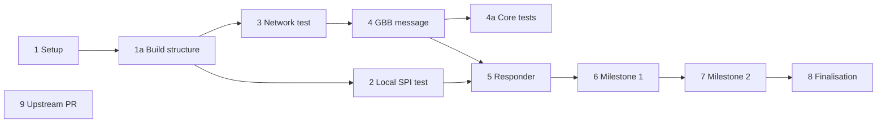

# Project Plan

| # | Task | Status |
|---|---|---|
| 1 | **Setup:** set up repo, Zephyr on both boards, read GBB spec (§9.4.14, Annex O, Annex J) | ✅ |
| 1a | **Build structure:** add Open1722 as submodule, split app into `common/` + `requester/` + `responder/` with role `.conf` files and overlays, replace the old I2C overlay with SPI1 | ✅ |
| 2 | **Local test on Board B:** read BME280, then show text on the OLED, all without network (raw SPI, OLED D/C and RES via GPIO) | ⬜ |
| 3 | **Network test:** Ethernet + static IPs, UDP echo A ↔ B | ⬜ |
| 4 | **GBB message:** Board A sends a GBB Write Request, Board B parses it and logs the bytes | ⬜ |
| 4a | **Core tests:** ztest suite for `common/` (framing, parsing, transaction matching) on `native_sim` | ⬜ |
| 5 | **Responder:** Byte Bus table (`byte_bus_id` → SPI config, CS, D/C), run the SPI transfer, send GBB Response, `err`=1 on failure | ⬜ |
| 6 | **Milestone 1:** Board A reads the BME280 chip ID remotely | ⬜ |
| 7 | **Milestone 2:** Board A polls the BME280 every second and shows it on the remote OLED, button cycles Display Pages, status LEDs, Link Stats page | ⬜ |
| 8 | **Finalisation:** docs, demo, cleanup | ⬜ |
| 9 | **Upstream PR:** fix `Avtp_Gbb_GetPayloadLength()` in Open1722 (see [Open1722 Notes](open1722-notes.md)) | ⬜ |

## Dependencies

- Tasks 2 and 3 need only setup (1) and the build structure (1a), so they can run in parallel.
- Task 4 needs the network (3), and the core tests (4a) need the GBB message code (4).
- Task 5 needs both the local SPI test (2) and the GBB message (4).
- Tasks 6 to 8 each build on the step before.
- The upstream PR (9) doesn't depend on anything else and can be done whenever there's time.

## Related

- [Architecture](architecture.md)
- [Hardware](hardware.md)
- [Open1722 Notes](open1722-notes.md)
