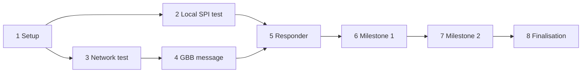

# Project Plan

| # | Task | Status |
|---|---|---|
| 1 | **Setup:** set up repo, Zephyr on both boards, read GBB spec (§9.4.14, Annex O, Annex J) | ⬜ |
| 2 | **Local test on Board B:** read BME280, then show text on the OLED, all without network | ⬜ |
| 3 | **Network test:** Ethernet + static IPs, UDP echo A ↔ B | ⬜ |
| 4 | **GBB message:** Board A sends a GBB write request, Board B parses it and logs the bytes | ⬜ |
| 5 | **Responder:** map `byte_bus_id` → SPI device, run the SPI transfer, send GBB response | ⬜ |
| 6 | **Milestone 1:** Board A reads the BME280 chip ID remotely | ⬜ |
| 7 | **Milestone 2:** Board A reads temperature, shows it on the remote OLED, button switches the page | ⬜ |
| 8 | **Finalisation:** docs, demo, cleanup | ⬜ |

## Dependencies

Tasks 2 and 3 only need the setup (1) and can be done in parallel. Task 4 needs the network (3), task 5 needs both the local SPI test (2) and the GBB message (4). Everything after that builds on the previous step.

## Related

- [Architecture](architecture.md)
- [Hardware](hardware.md)