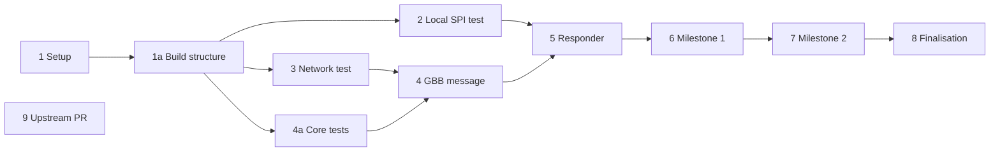

# Project Plan

| # | Task | Status |
|---|---|---|
| 1 | **Setup:** set up repo, Zephyr on both boards, read GBB spec (§9.4.14, Annex O, Annex J) | ✅ |
| 1a | **Build structure:** add Open1722 as submodule, split app into `common/` + `requester/` + `responder/` with role `.conf` files and overlays, replace the old I2C overlay with SPI1 | ✅ |
| 2 | **Local test on Board B:** read the BME68x, then show text on the SHARP display, all without network | 🟡 |
| 3 | **Network test:** Ethernet + static IPs, UDP echo A ↔ B | ✅ |
| 4a | **Core tests:** GBB framing and parsing in `common/` with a ztest suite on `native_sim` (Write/Read Request build, Response parse, `transaction_num` matching, malformed datagrams) | ⬜ |
| 4 | **GBB message:** Board A sends a GBB Write Request built with the `common/` code from 4a, Board B parses it and logs the bytes | ⬜ |
| 5 | **Responder:** Byte Bus table (`byte_bus_id` → `spi_config` incl. CS polarity and bit order), run the SPI transfer, send GBB Response, `err`=1 on failure. Bring the code in line with the new hardware: Byte Bus enum in `protocol.h`, Responder overlay (CS lines), remove OLED D/C and RES | ⬜ |
| 6 | **Milestone 1:** Board A reads the BME68x chip ID (`0x61`) remotely | ⬜ |
| 7 | **Milestone 2:** Board A polls the BME68x every second and shows it on the remote display, button cycles Display Pages, status LEDs, Link Stats page | ⬜ |
| 8 | **Finalisation:** docs, demo, cleanup | ⬜ |
| 9 | **Upstream PR:** fix `Avtp_Gbb_GetPayloadLength()` in Open1722 (see [Open1722 Notes](open1722-notes.md)) | 🟡 |

✅ done · 🟡 in progress · ⬜ not started

## Dependencies

- Tasks 2 and 3 need only setup (1) and the build structure (1a), so they can run in parallel.
- The core tests (4a) run on `native_sim` and need no hardware, so they only need the build structure (1a).
- Task 4 needs the network (3) and the core (4a).
- Task 5 needs both the local SPI test (2) and the GBB message (4).
- Tasks 6 to 8 each build on the step before.
- The upstream PR (9) doesn't depend on anything else and can be done whenever there's time.

## Progress Notes

- **Hardware change:** the project now uses an Adafruit SHARP Memory Display 1.3" (LS013B7DH05) and a BME68x instead of the SSD1306 OLED and the BME280. The code in `app/` still reflects the old hardware and is adapted in task 5.
- **Task 2:** standalone examples in [`examples/`](../examples) cover SPI on Board B without network: [`hello_world`](../examples/hello_world) (text on the display), [`air_quality`](../examples/air_quality) (sensor values on the display, two CS lines on SPI1) and [`cookie_clicker`](../examples/cookie_clicker) (demo). They use Zephyr's `ls0xx` and `bme680` drivers.
- **Task 3:** the Requester pings the Responder once per second over UDP port 17220 and logs the round-trip time; the Responder echoes. LEDs show link OK / error. Testing with one board and a PC is in [Debugging](debugging.md).
- **Task 9:** PR to COVESA/Open1722 is open and waiting for approval.

## Related

- [Architecture](architecture.md)
- [Hardware](hardware.md)
- [Open1722 Notes](open1722-notes.md)
