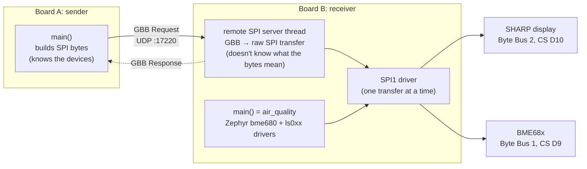
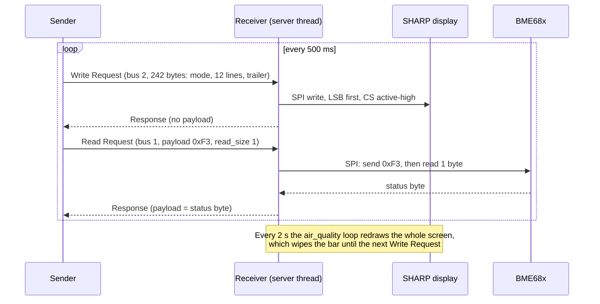

# Remote SPI example

> **Note:** this is a learning example, not the final app. It shows one GBB Write Request and one GBB Read Request going from one board to the other, built with Open1722. The real project code lives in [`app/`](../../app).

Two NUCLEO-F439ZI boards, connected directly with an Ethernet cable:

- **Receiver** (board B, `192.168.1.11`): runs the [`air_quality`](../air_quality) example unchanged, and also a remote SPI server that runs SPI transfers sent to it over Ethernet.
- **Sender** (board A, `192.168.1.10`): has no SPI devices. It writes SPI bytes for the receiver's devices into GBB messages and sends them. Twice per second it paints a checkered bar on the receiver's display and reads the BME68x status register.

## Architecture



**Who knows what.** The sender holds all device knowledge: it knows that the display wants a mode byte, a line address, 18 pixel bytes and dummy bytes, and that the BME68x wants a register address with bit 7 set for a read. The receiver only knows a table that maps a **Byte Bus ID** to an SPI device (chip select, bit order, SPI mode). It clocks bytes out and reads bytes in without looking at them. That is what "generic byte bus" means, and it's the same split as in the main app ([ADR 0001](../../docs/adr/0001-responder-is-a-dumb-byte-bus.md)).

**One datagram, one GBB message.** Every request and every response is a single UDP datagram:

```
| UDP | Annex J (4 B) | NTSCF header (12 B) | GBB header (16 B) | payload | pad to 4 B |
```

| Layer | What it's for | Built by |
|---|---|---|
| UDP/IP | Gets the bytes from board A to board B | Zephyr sockets |
| Annex J | IEEE 1722 over UDP: one sequence number in front | `Avtp_Udp_*` |
| NTSCF | IEEE 1722 frame that carries control messages (ACF), with stream ID and length | `Avtp_Ntscf_*` |
| GBB | The SPI transfer itself: which bus, write or read, transaction number, bytes | `Avtp_Gbb_*` |

[`common/remote_spi.c`](common/remote_spi.c) wraps a finished GBB message in the Annex J and NTSCF headers (`frame_finish`) and unwraps and checks them again (`frame_parse`). Both boards use it.

**The two kinds of request.**

| | Write Request (`op`=1) | Read Request (`op`=0) |
|---|---|---|
| Sender puts in the payload | All bytes to clock out | The bytes to clock out first (register address) |
| Extra field | none | `read_size`: how many bytes to read afterwards |
| Receiver does | `spi_write_dt`, one CS assertion | `spi_transceive_dt`: payload out, then `read_size` bytes in, one CS assertion |
| Response payload | empty | exactly the bytes read |

Every response has `rsp`=1, echoes `transaction_num` and sets `err`=1 if the receiver couldn't run the transfer (unknown bus, wrong direction, SPI error). The sender throws away responses whose `transaction_num` doesn't match, for example a late answer to a request that already timed out (200 ms).

## Sequence



## Sharing SPI1 with the local drivers

The receiver's `main()` still uses Zephyr's `bme680` and `ls0xx` drivers, so two "owners" share the same bus:

- **No mixed-up bytes on the wire.** Zephyr's SPI driver lets only one transfer use SPI1 at a time. A remote transfer waits until a local one is done, and the other way round.
- **The display** is fine to write from both sides. The local loop redraws the full screen every 2 seconds, so the sender's bar blinks: it appears with the next Write Request and is gone after the next local redraw.
- **The sensor is read-only remotely.** The `bme680` driver caches which register page (0 or 1) the BME68x is on. A remote write could switch the page behind its back and break the local readings, so the receiver answers Write Requests on the sensor bus with `err`=1. The sender reads the `status` register (0x73), which is reachable from both pages. Its bit 4 shows the page the local driver left selected (page 1 after start-up). Reading the chip ID (0xD0, page 0) would return the wrong register while the driver is on page 1.

The main app avoids all of this because its Responder has no local drivers.

## Wiring

Same as [`air_quality`](../air_quality), with one change: **move MOSI from D11 (PA7) to PB5**. PA7 is the Ethernet RMII CRS_DV pin on this board, so it can't be used for SPI once networking is on. Check the header position of PB5 in the NUCLEO-144 user manual (UM1974). The full pin list is in [`receiver/app.overlay`](receiver/app.overlay). The sender needs only the Ethernet cable.

## Build and flash

From the workspace folder in the dev container, with each board plugged in in turn:

```bash
# Board B (with display and sensor)
west build -p always -b nucleo_f439zi examples/remote_spi/receiver -d build/remote_spi_receiver
west flash -d build/remote_spi_receiver

# Board A
west build -p always -b nucleo_f439zi examples/remote_spi/sender -d build/remote_spi_sender
west flash -d build/remote_spi_sender
```

On the sender's serial console you should see something like this (only bit 4 of the status byte has a defined meaning, so the other bits may differ):

```
<inf> sender: sender up: 192.168.1.10 -> 192.168.1.11:17220, timeout 200 ms, display bar 242 B
<inf> sender: request 1: display write ok
<inf> sender: request 2: sensor status 0x10 (register page 1)
```

## Debugging

Both boards log to the serial console (ST-LINK virtual COM port, 115200 baud). The log level for the example's own messages is set for both boards at once in [`common/debug.conf`](common/debug.conf) (`CONFIG_REMOTE_SPI_LOG_LEVEL_DBG/INF/WRN/ERR`). It can also be changed at runtime in the shell, e.g. `log enable inf sender`.

| Level | What you see |
|---|---|
| ERR | Socket errors, SPI failures, devices not ready |
| WRN | Timeouts, `err`=1 answers, rejected requests with the reason, dropped datagrams with the reason |
| INF | One line per transfer, sender's link stats (min/avg/max round trip) every 20 requests, receiver's Byte Bus table at start-up, sensor values every 2 s |
| DBG | Every GBB header field, Annex J/NTSCF sequence numbers and lengths, the first 64 bytes of each payload and SPI transfer, SPI time incl. waiting for the bus |

Log modules: `sender`, `receiver` and `remote_spi` (the shared frame code). Logging is deferred: a log call only copies the message into a buffer, so it doesn't slow down the transfers.

The shell also has network commands:

| Command | Answers |
|---|---|
| `net iface` | Is the link up, and is the static IP set? |
| `net ping 192.168.1.11` | Does the other board answer at all, without GBB? |
| `net stats` | How many packets were sent, received and dropped per protocol |

Where to look first:

| Symptom | Likely cause |
|---|---|
| Sender: `sendto failed`, `net iface` shows no link | Cable, or the other board isn't running |
| Sender: `no answer within 200 ms`, receiver logs nothing | Receiver not flashed, wrong IP, or `net ping` fails too |
| Receiver: `not a valid NTSCF frame` / `not a valid GBB message` | Something other than the sender is sending to port 17220; the warning has the header values and a hex dump |
| Receiver: `rejected: ...` | The sender asked for something the Byte Bus table doesn't allow (the warning says what) |
| Receiver: `the sensor is not ready` at boot | SPI wiring, most often MOSI still on D11 instead of PB5 |
| Status byte always `0xff` | MISO (D12) or sensor CS (D9) not connected: nobody drives MISO |
| Bar never appears, display write `ok` | Display CS (D10) or MOSI wiring; check the receiver's start-up Byte Bus line against the wiring |

## Files

| File | Content |
|---|---|
| [`common/remote_spi.h`](common/remote_spi.h) | Port, IPs, Byte Bus IDs, frame helpers |
| [`common/remote_spi.c`](common/remote_spi.c) | Wrap/unwrap a GBB message in Annex J + NTSCF, GBB field logging |
| [`common/network.conf`](common/network.conf) | Network Kconfig shared by both boards |
| [`common/debug.conf`](common/debug.conf) | Log level, logging mode, shell, shared by both boards |
| [`common/Kconfig`](common/Kconfig), `*/Kconfig` | Adds the `CONFIG_REMOTE_SPI_LOG_LEVEL` option |
| [`sender/src/main.c`](sender/src/main.c) | Builds the requests and waits for the answers |
| [`receiver/src/main.c`](receiver/src/main.c) | Remote SPI server thread and the air_quality loop |
